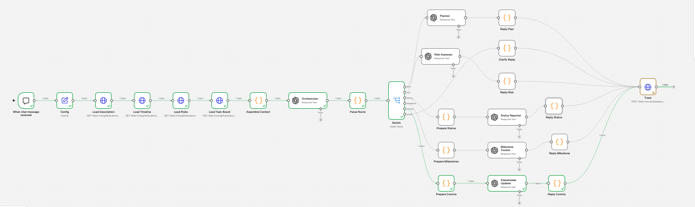

# Mira: AI-Powered Project Intelligence Assistant

Capstone project, Applied Agentic AI for PMs/TPMs.

## What Mira is
- The problem: Nexora's PMs lose hours on plans, status reports and risk assessments in inconsistent formats.
- What Mira does: it turns four project files into plans, risk matrices, status reports, milestone alerts and stakeholder updates.
- The biggest risk: invented milestones, risks or task statuses, so every answer has to be grounded in the files or admit missing information.
  
## Architecture

Pattern: Router / Dispatcher. One Orchestrator (AI) classifies each request and checks that there is enough data. A Code node computes counts, sprint filters, overdue tasks and date windows. A Switch then sends the request to one of six branches: Planner, Risk Assessor, Status Reporter, Milestone Tracker (extended), Stakeholder Updater (extended) or a fixed Clarify reply. Every branch ends in one Langfuse Trace node. See docs/Q2_architecture_writeup.md for the full design.

## Tools used
| Category | Tool | Why |
|---|---|---|
| Workflow | n8n Cloud | Visual router (Switch), CSV loading, Code nodes for deterministic counts |
| LLM | OpenAI gpt-4o-mini | Cheap and fast enough for structured generation from provided data |
| Observability | Langfuse (US cloud, OTLP endpoint) | One trace per request, with input, output and route tag |
| Data | GitHub raw files in /data | Four project files, no authentication needed |

## Repo structure
- /data: project input files
- /workflow: n8n workflow export (Mira_workflow.json, no secrets)
- /docs: notes, cost analysis and metrics, writeup, charter, reflection
- /results: baseline test outputs (T01 to T12), screenshots, Langfuse traces

## How to run
1. Import workflow/Mira_workflow.json into n8n (Workflows, Import from file).
2. Create an OpenAI credential and a Basic Auth credential named "Langfuse" (public key as user, secret key as password; US endpoint).
3. Check the Config node values: as_of_date 2026-04-22, project_start 2026-04-06, current_sprint Sprint 3.
4. Open the chat and send a request, for example "Generate a weekly status report using the sample task board data for Sprint 3."

## Baseline test results
All 12 tests pass (see results/baseline_results.md). Prompt fixes were documented for T1, T3, T7, T10 and T12.

## Known limitations
- The project timeline uses weeks, so Week 1 is assumed to start on 2026-04-06; "today" is fixed by the as_of_date setting.
- The risk register has no probability or severity scores, so rankings are judgments backed by task evidence.
- The problem statement says 3 tasks are Done, but the task board has 5; Mira uses the data.
- The task board ends about Week 18, while the timeline runs to Week 24.
- Langfuse's legacy ingestion endpoint stops accepting traces on 2026-11-16; this workflow uses the OTLP endpoint instead.
- Token usage for the model calls is read from the n8n execution view, not traced as separate generations.
