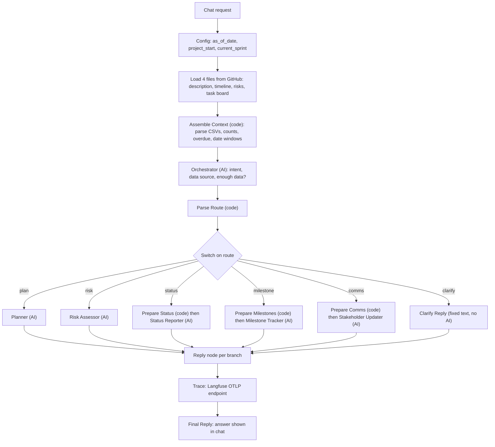

# Mira: Architecture Writeup (Q2)

Author: Sathish Doraiswamy | Nexora Pvt. Ltd. | AI Adoption Project, ABCDE Ltd.

## 1. Problem summary
Nexora's PMs and TPMs manage several projects at once and lose hours building plans (3-4 hours each), compiling weekly status reports (1-2 hours) and doing risk assessments in inconsistent formats. Mira turns four project files (description, timeline, risk register, task board) into structured plans, risk matrices, status reports, milestone alerts and stakeholder updates. The biggest risk is fabrication (invented milestones, risks or task statuses), so every output must be grounded in the files or say that information is missing.

## 2. Architecture

Screenshot of the built workflow: results/Workflow_canvas.png.

## 3. Tool selection
| Category | Choice | Why |
|---|---|---|
| Workflow platform | n8n Cloud | Used in class; its Switch node gives a clean router; Code nodes let me compute counts and dates deterministically |
| LLM | OpenAI gpt-4o-mini | The tasks are structured generation from supplied data, so a cheap, fast model is enough (about $0.001 per heavy request) |
| Observability | Langfuse | Set up in class; one trace per request with input, output and route tag |
| Data ingestion | GitHub raw files | Four static files; no OAuth needed |

## 4. Orchestration pattern: Router
Requests are different types (plan, risk, status, milestones, comms) and each needs different data and a different output format. A sequential pipeline would run every agent on every request and make the status agent run when someone only wants a plan. The Router also holds the most important safeguard: the Orchestrator decides whether there is enough data, and vague requests go to a fixed Clarify reply instead of the AI, so nothing can be invented.

## 5. Agents
| Agent | Job | Input | Key prompt rules |
|---|---|---|---|
| Orchestrator | Classify the request and check data sufficiency | User request | Return JSON only; never guess a sprint; inline text must contain scope, goals and timeline or team |
| Planner | Plan with phases, milestones and dates | Description, timeline | Use only timeline phases; "Not specified in source" for gaps; state the Week 1 start-date assumption |
| Risk Assessor | Risk matrix or top-N risks | Risk register, task evidence | Only register risks; no invented scores; rank by task evidence (Blocked, then Overdue, then Due soon) |
| Status Reporter | Weekly status report | Counts computed by code | Copy counts exactly; list every status; blocker taken from the task description |
| Milestone Tracker (extended) | Blocked or at-risk tasks, upcoming milestones | Blocked, overdue and due-soon lists, phases in a 14-day window | Dates come from code; suggestions are labeled; dependencies labeled as inference |
| Stakeholder Updater (extended) | Sprint email | Tasks of one sprint only | Code filters the sprint, so later sprints never reach the model; overdue tasks must appear under Risks |

## 6. Cost analysis (gpt-4o-mini, $0.15 per 1M input and $0.60 per 1M output tokens)
| Call | Input | Output | Cost | Source |
|---|---|---|---|---|
| Orchestrator | 393 | 29 | $0.0000764 | Measured |
| Status Reporter (25 tasks) | 2,480 | 973 | $0.0009558 | Measured |
| Planner, Risk, Milestone, Comms | ~1,200 to 2,200 | ~250 to 1,100 | ~$0.00035 to $0.00099 | Estimated |

Every request pays for the Orchestrator plus one specialist; vague requests pay only for the Orchestrator. A typical mix of 15 requests per user per day costs about $0.0093 per day, about $0.20 per user per month (details: docs/cost_and_metrics.md).

## 7. Evaluation strategy: production metrics
1. **Plan groundedness**: share of plan phases and milestones traceable to the timeline file (baseline 8 of 8).
2. **Status accuracy**: share of task counts matching the task board, computed in code (baseline 100%).
3. **Risk relevance**: share of listed risks that come from the register, with task-evidence links (baseline 10 of 10).
4. Trust: hallucination rate in traced runs (baseline 0 of 12). Usefulness: PM time saved per week, to be measured in a pilot.

## 8. Testing observations
All 12 baseline tests pass, and all were re-run with tracing on. Vague inputs (T2, T4, T6, T9) were correctly answered with a request for more detail and no invented content. Failures found and fixed through traces and outputs:

| Issue found | Test | Fix |
|---|---|---|
| Plan missed the Week 1 start-date assumption and had a stray "Not specified" bullet | T1 | Added prompt rules 6 and 7 |
| Risk assessment also printed an unrequested top-3 list | T3 | Rule "answer only what was asked" |
| Top 3 risks were generic (R01, R02, R04) and ignored the Blocked task | T7 | Rule to rank by task evidence; result became R09, R01, R05 |
| Blocker detail missing, then To Do list omitted | T10 | Passed the task description field through; added rule to list every status |
| Overdue task not named under Risks; placeholder name in sign-off | T12 | Added rules 5 and 6 |
| Tracing: legacy endpoint returned 201 but showed nothing in Langfuse v4; chat then showed the ingestion receipt | Observability | Switched to the OTLP endpoint; added a Final Reply node |

Data issues found: the problem statement says 3 Done tasks but the board has 5; the board ends around Week 18 while the timeline runs to Week 24; the timeline CSV and PDF word Phase 8 differently; the risk register has no severity scores.

Key lesson: counts, dates and filtering are computed in code and the model only writes the narrative, which is why status counts were never wrong.
